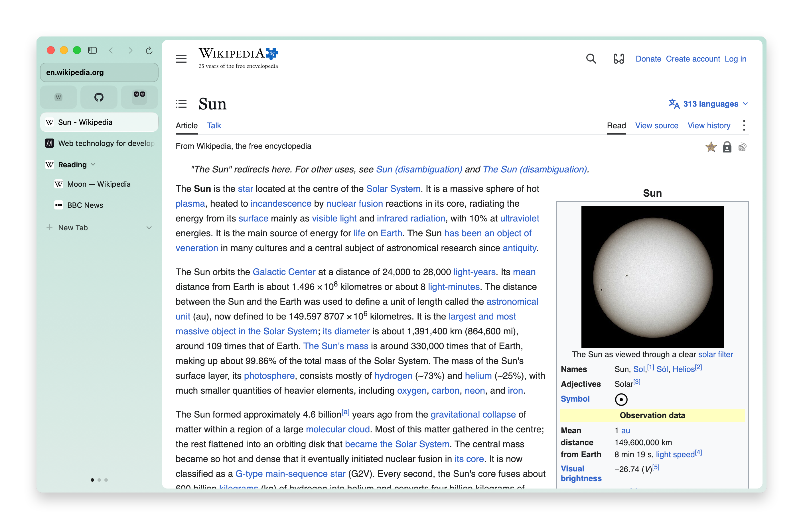
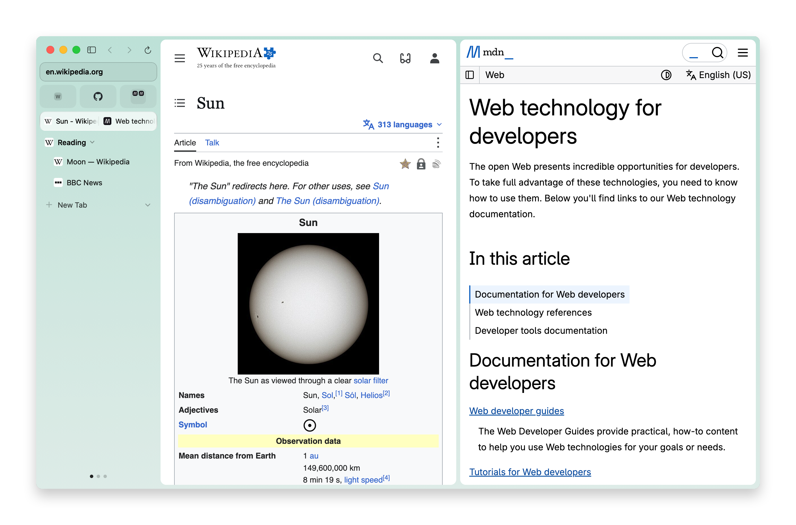
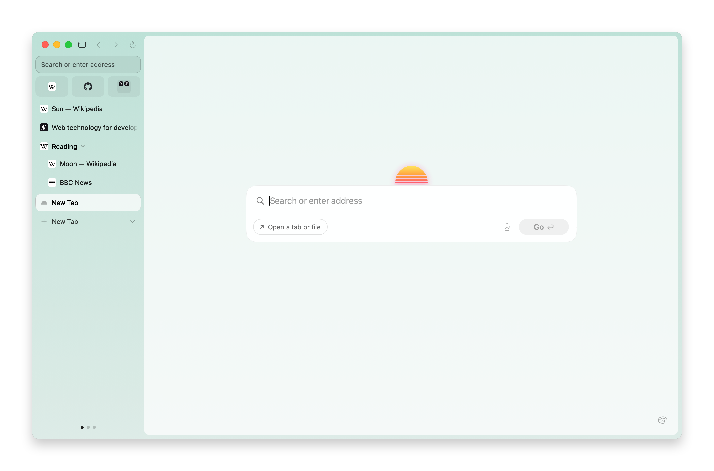
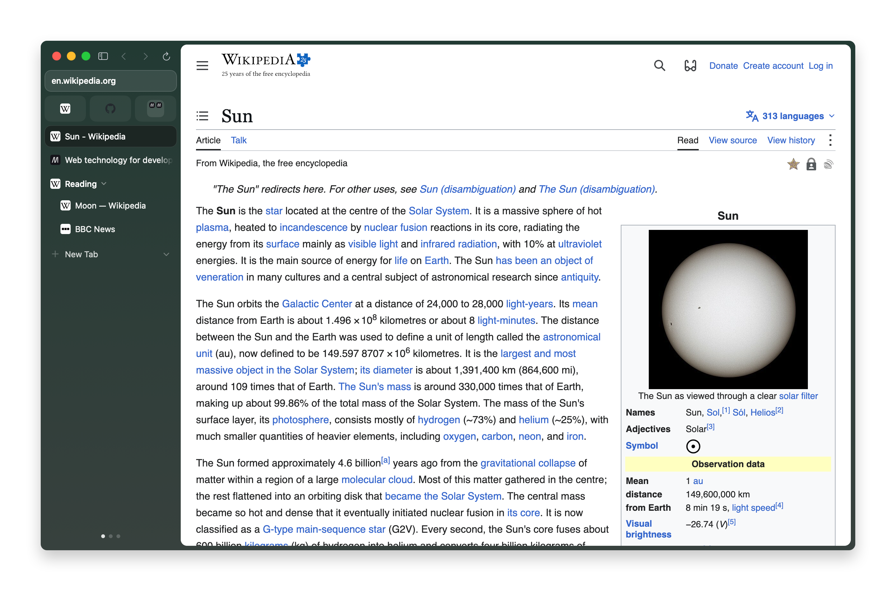

<p align="center">
  
</p>

<h1 align="center">Solara</h1>

<p align="center">
  A browser for macOS, with Arc's sidebar and Dia's polish.<br>
  Chromium built from source. No account, no AI features, no telemetry.
</p>

<h3 align="center">
  <a href="https://github.com/andrewbenson/solara/releases/latest">Download Solara for Mac</a>
</h3>

<p align="center">
  macOS 26 or later · Apple Silicon<br>
  Signed with a Developer ID and notarized by Apple.<br>
  <a href="https://github.com/andrewbenson/solara/releases">Releases and release notes</a>
</p>

## Tabs in the sidebar

Keep pinned sites as tiles. Put related tabs in folders. Use the dots at the bottom to switch profiles.



## Pages side by side

Split a window to keep pages together. A split can hold up to three tabs.



## A sun on New Tab

Open a new tab to start a search beneath Solara's sun.



## Light and dark

Choose a profile color and a light or dark appearance.

| Light | Dark |
| --- | --- |
|  |  |

## Also in Solara

- **Command bar.** Command-L finds tabs, bookmarks and history, or searches the web.
- **Peek.** Open a link over the page, then close it or keep it as a tab.
- **No account.** Sync, if you turn it on, goes through a folder in your own iCloud Drive, end-to-end encrypted.
- **No telemetry.** No usage data and no crash reports. Google's background services are compiled out of the engine,
  and uBlock Origin is built in.
- **Chrome extensions** install from the Chrome Web Store.
- **Moves in for you:** bookmarks, history, passwords, cookies and tabs from Chrome, Safari, Firefox, Arc, Dia and
  more.

## Getting it

Download the DMG from [the latest release](https://github.com/andrewbenson/solara/releases/latest). Open it and drag
Solara to Applications.

If you used 0.0.1, install 0.1.0 from the DMG over it. 0.1.0 has a new app identity and starts with a fresh profile;
0.0.1's tabs and data aren't brought over. From 0.1.0 on, updates install themselves.

Solara uses [Sparkle](https://sparkle-project.org) to install updates from GitHub Releases. Choose Stable or Nightly
in Settings › General › Update channel. Stable receives stable releases. Nightly receives newer prereleases and
stable releases. Switching back to Stable waits for a newer stable build; it does not downgrade.

## Build from source

You need an Apple Silicon Mac, Xcode, CocoaPods, Node 22.13 or later, and pnpm 11. Use the Node version in `.nvmrc`.

```sh
pnpm install
pnpm pods
```

Start Metro in one terminal. Reuse it if it is already running.

```sh
pnpm dev
```

In another terminal, build and run the Debug app. It uses its own data folder, `Solara Dev`, unless you set
`SOLARA_DATA_DIR`.

```sh
pnpm macos
```

The app links a Chromium framework. If you have a local engine build in `~/chromium-build`, the app build uses it.
Otherwise, it downloads a prebuilt engine that matches your checkout's `engine/` tree and verifies its SHA-256.
If no matching engine is available, build it from source or use the release tag named by the error.
[docs/engine-build.md](docs/engine-build.md) covers the engine build.

See [CONTRIBUTING.md](CONTRIBUTING.md) for contributing, [docs/agent-brief.md](docs/agent-brief.md) for the architecture
and hidden development instances, and [docs/releasing.md](docs/releasing.md) for signed releases.

## License

Solara as distributed, the app together with its engine, is licensed under the
[GNU General Public License v3](LICENSE), because the engine is built with Helium's patches, which are GPL-3.0. Its
own source files are under the [Apache License 2.0](LICENSE.Apache-2.0). It also builds on
Chromium (BSD-3-Clause and others), ungoogled-chromium and a few Chromium Embedded Framework patches (BSD-3-Clause),
and bundles uBlock Origin (GPL-3.0) and Sparkle (MIT), each under its own license. [NOTICE](NOTICE) has the full list
and where each release's corresponding source is.

Solara began from [Ardia](https://github.com/mantrakp04/ardia) by Mantra Patel (Apache-2.0); see NOTICE.
