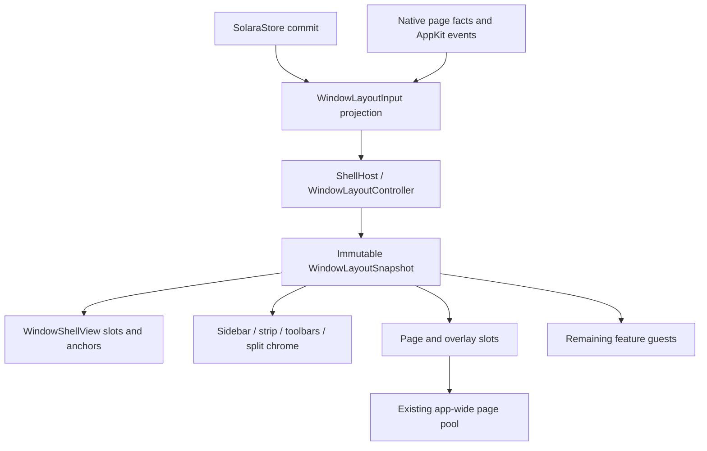

# 0.4.0 layout port: design and patch plan

**Baseline:** `209d9238` (v0.3.4). All source references below are repository-relative `file:line` at that revision. Proposed names and estimates are design choices, not existing APIs. This document is the design and its implementation plan.

**Goal:** one Swift layout owner for each browser window, with left/right sidebar placement, viewport-sized reusable sidebar rows, native pane and overlay geometry, and chrome-first launch scheduling.

**Architecture:** extend the existing `ShellHost`; reuse `WindowShellView`, native sidebar/strip/split views, and the app-wide page pool. Observe canonical Swift state directly and apply one coherent window presentation per update. React may continue to run application services and unported features, but supplies no view, frame, animation, hit region, or layout policy for the surfaces in this port.

**Stack:** AppKit and SolaraKit (`SolaraModel`, `SolaraStore`, `SolaraUI`), package adapters in `packages/settings` and `packages/shell`, SolaraCore page adapters. This plan is its own design/specification for the four layout-related rows in `docs/roadmap.md:212`.

## Scope and constraints

- Written as a plan before any implementation.
- Future implementation follows AGENTS.md: new UI in Swift, no comments in code, shared checkout preserved, behaviour changes covered by tests. Commands below describe future checks, not checks performed for this design.
- The roadmap's general 0.4.0 gate permits RN to arrange native views (`docs/roadmap.md:202`). This layout port intentionally goes further for these surfaces: RN neither draws nor arranges them. It does not claim that every other 0.4.0 row is complete.
- Do not pull all commands, menus' action logic, drag business rules, sync, persistence, and the JS mirror into this port. Those remain 0.5.0/0.6.0 work (`docs/roadmap.md:217`). Existing JS action adapters can remain headless; Swift owns presentation and pointer-to-layout interpretation.
- Regular/private browser windows use the same owner; Little Solara and utility windows retain their separate hosts. Their page transfers and focus must continue working. The separate native Little Solara/calendar/media/content ports are dependencies for deleting their RN content, not hidden scope here.
- Preserve native workspace-off and safe-mode policies until the final cutover is validated. A capability selects one complete layout path for a window at creation; never mount two competing owners.

## 1. Current ownership

### What React Native still decides or draws

Paths in this table start at `apps/browser/src/`.

| Surface | Current RN responsibility and evidence |
| --- | --- |
| Window composition | `App.tsx:44` selects top/sidebar and page-fullscreen mode, measures width, creates the content/side-panel row, supplies insets, and mounts strip/peek/sidebar and window overlays. These decisions persist with the native shell on. |
| Dock, sidebar reveal and gutters | `components/layout/SidebarDock.tsx:163` resolves saved/live width, address-bar mode, open state and native capability. `:182` pushes shell layout; `:199` still lays out an animated padded card; `:222` positions strip/peek hosts; `:232` publishes native dock state. `:277` positions native sidebar hosts. The fallback owns edge watching, negative-X slides, peek, lights and animations (`:55`, `:318`, `:449`). `nativeDock.ts:36` mirrors native motion back into JS animation state. |
| Sidebar chrome and rows host | `components/Sidebar.tsx:25` calculates header/footer/list bounds. `components/sidebar/NativeSidebar.tsx:100` constructs appearance, flags and selection; `:143` publishes the native column's header/bottom/clip data; `:184` handles native actions in JS; `:310` supplies controls/profile/media presentation. Width/rail interactions still return through JS at `:74`. Native rows draw the pixels, but RN determines their host's existence and some layout inputs. |
| Top tab strip | `components/layout/TopTabStrip.tsx:116` computes lights reservation, controls width, clipping and available tab width. `NativeTopStrip.tsx:260` mounts the native strip inside an RN absolute-fill host. Floating peek still takes RN dimensions and callbacks (`TopTabStrip.tsx:1653`, `NativeTopStrip.tsx:275`). The large RN strip fallback also draws tabs/groups, controls, drop glow and peek. |
| Card and split panes | `components/ContentCard.tsx:147` calculates pane rectangles/fullscreen coverage using `layout/geometry.ts:25`. `:225` derives toolbar positions; `:231` and `:247` publish URL/card anchors; `:251` measures RN container size/origin; `:267` computes toolbar/bookmark page tops and sends them to native. `:305` chooses and positions pane hosts, native split toolbars, frozen pages, peek and drop surfaces. `:420` still arranges each pane's toolbar, bookmarks, overlays, page/background and auto-hide state. Pooling removes RN page mounting, not this layout work. |
| Native split bridge | `components/layout/nativeSplitChrome.ts:27` publishes theme, fullscreen and page tops; `:138` sends drag state. `SplitChrome.tsx:90` retains JS split-drop interpretation even where preview pixels are native. Native drag-session paths also exist; they must be reconciled, not duplicated. |
| Toolbar auto-hide/fullscreen | `components/layout/toolbarAutoHide.ts:23` maintains per-tab scroll/peek maps and `:57` decides shown/collapsed/peek; open command/find bars force it shown at `:62`. `pageState.ts:91` chooses the fullscreen tab among the active split and Peek using JS page facts. Window Spaces fullscreen is a different native state. |
| Back/forward swipe | `components/layout/SwipeOverlay.tsx:51` measures page area, owns gesture/confirmation/list state and timers; `:89` starts a gesture, `:119` confirms, `:134` requests history and expands the list. It sends drawing commands to native in shell windows but still owns the `SwipeArea` and navigation selection. RN fallback draws the capsule/history list; `:40` also mounts history navigation overlays. |
| Pane roots | `PaneRoot.tsx:12` registers a per-tab RN root drawing `PaneContent` through `:26`. `ContentCard.tsx:420` remains the pane content/layout entry. This is separate from the main root; deleting only `App.tsx` layout leaves RN pane machinery alive. |
| Extension room and shared anchors | `components/extensions/SidePanel.tsx:30` reserves width, `:78` sends side-panel room/insets. `components/CommandPanel.tsx:146` and `components/onboarding/tour/anchors.ts:39` consume layout anchors. These consumers need a native anchor provider before measurements are removed. `layout/ShellBackdrop.tsx:18` still feeds native appearance. |

The geometry feedback loop is explicit: `components/layout/shellLayout.ts:21` sends RN-derived inputs and optionally per-frame dock progress to Swift, while `ContentCard` measures RN and sends page tops back. It can leave native hosts using facts from different render turns.

### What native already owns

| Owner | Current responsibility and evidence |
| --- | --- |
| OS/Chrome window | `packages/shell/ios/Windows.swift:22` manages windows, delegates, close/retention and placement; `:220` embeds content into Chrome's window. The window factory/root factories come from `apps/browser/macos/Solara-macOS/AppDelegate.swift:25`. Preserve the Chrome-backed NSWindow and Browser relationships. |
| Per-window shell | `packages/settings/ios/WindowShell/NativeWindowShell.swift:34` wraps the content factory; `:87` defines `ShellHost`; `:123` starts pane roots and profile pager. It owns shell, pane-root/pager/side-panel lifetime, but not every sidebar/strip/split/peek controller. `:108` forwards RN content-appearance to reveal the shell. |
| Shell tree/geometry | `native/SolaraKit/Sources/SolaraUI/WindowShell/WindowShellView.swift:5` defines ordered slots, card clips, overlay and hidden-page containers; `:186` accepts typed changes; `:331` handles native resizing; `:527` relays geometry to mounted surfaces. `ShellGeometry.swift:103` defines inputs and `:162` calculates dock/card/page/sidebar/strip/side-panel/lights frames. Geometry already runs against native bounds; it lacks sidebar-side input and still accepts RN-derived policy. |
| Sidebar/dock | `packages/settings/ios/Sidebar/NativeSidebar.swift:110` is a native store-subscribing host, but `:163` waits for JSON host state. `NativeSidebarShell.swift:22` observes `sidebar.shell`, consumes RN header/bottom values at `:43`, and mounts a native column at `:50`; legacy hosted-view construction remains at `NativeSidebar.swift:18`. Swift already draws header/footer/rows and performs dock/resize motion. `packages/shell/ios/LeftEdge.swift:69` and `:87` hard-code the left edge, including occlusion, active-app and Dock handling. |
| Strip | `packages/settings/ios/TopStrip/NativeTopStrip.swift:195` hosts native strip views; `:228` subscribes to store; `:257` still requires JSON host state. Native strip and peek already implement drawing, groups, controls and motion; separate hosted/peek paths begin at `:114` and `:127`. |
| Splits/overlays | `packages/settings/ios/Split/NativeSplitChrome.swift:18` holds process-wide per-window view dictionaries; `:34` listens to JS topics and `:44` to store. Swift already constructs panes, dividers, overlays and native drop zones (`:95`, `:122`), dispatches resize/split actions, and lays out splits (`native/SolaraKit/Sources/SolaraUI/Split/SplitPanesView.swift:157`). Theme/fullscreen/page-top/toolbar payloads still arrive from JS (`NativeSplitChrome.swift:170`, `:214`). |
| Peek and profile pager | `packages/settings/ios/WindowShell/NativePeek.swift:13` listens to `peek.state`; `:73` owns a native `PeekOverlayView`, pooled page slot and transitions, but receives JSON and sends events to JS. ShellHost starts the native profile pager at `NativeWindowShell.swift:124`; it already avoids RN swipe/tint/profile views in the shipped native path. |
| Pane-root lifecycle | `packages/settings/ios/PaneOverlays/NativePaneRoots.swift:73` creates RN roots in native overlay slots; `:108` selects visible roots, `:119` invalidates ended roots. Native owns placement/lifetime, RN owns their contents. |
| Page pool | `packages/settings/ios/TabPool/TabPoolHost.swift:13` requires native shell/pages/pane roots, an opened native workspace and pool enablement; `:40` starts the app-wide pool. `native/SolaraKit/Sources/SolaraUI/TabPool/TabViewPool.swift:99` reconciles page identity/placement; `:220` holds the outgoing page until incoming draw or 250 ms. This is page lifetime and focus infrastructure, not sidebar row virtualization. |
| Update scheduling | `native/SolaraKit/Sources/SolaraUI/Services/FrameUpdates.swift:11` coalesces by owner; `:17` drains up to eight passes, continuing next turn; `:53` flushes before run-loop waiting/exit in common modes. It is not an idle-work budget or a guaranteed display-frame transaction. |
| Authoritative state | `apps/browser/src/store/nativeStore.ts:32` mirrors the native workspace into Zustand. Window overrides already live in Swift (`native/SolaraKit/Sources/SolaraModel/Entities.swift:65`, `:118`); sidebar commands preserve other windows' effective values (`native/SolaraKit/Sources/SolaraStore/Windows.swift:201`). Read native state directly rather than subscribe to its React projection. |

**Why 200 tabs are expensive:** `native/SolaraKit/Sources/SolaraUI/Sidebar/SidebarView.swift:291` computes a complete lightweight layout, then `:323` realizes every item. `:333` retains a view by stable item key or creates one. Scrolling at `:486` updates edge/pill/pointer without changing realization. This is reuse of the same tab's view, not reuse between tabs. `SidebarPager.swift:94` hides distant pages but retains created page trees (`:109`) and warms neighbors (`:128`). Top-strip items are also realized in full (`TopStrip/StripPageView.swift:138`). The ~480 ms is the roadmap's observed launch cost, not a measurement made in this job.

## 2. Target ownership and contracts

### Approach

Considered retaining RN as the geometry coordinator, rewriting the window and all pages at once, and consolidating the existing native hosts incrementally. Retaining RN would write the right-side geometry twice and leave the measured feedback loops; a wholesale rewrite would risk Chrome page/focus ownership and mix later roadmap work into 0.4.0. This design proposes incremental native consolidation because the rendering and most geometry already exist. The user specified the Swift target; these implementation tradeoffs are the design’s recommendation.

### One owner, existing infrastructure

Add `WindowLayoutController` under `native/SolaraKit/Sources/SolaraUI/WindowShell/`, owned once by the existing `ShellHost`. Keep framework-specific page/window/Expo wiring in `packages/settings`. The controller owns native sidebar/strip/peek-strip, split/pane presentation, reveal/resize/auto-hide and swipe/Peek controllers, anchor registry, hit regions, drag gutters, modal accessibility and their start/stop. Split implementation can remain in child types; one owner means one authority and lifetime, not a monolithic Swift file.

Keep OS window lifecycle in `WindowManager`, canonical state in `SolaraStore`, and cross-window pages/registry in the existing app-wide `TabPoolHost`/`TabViewPool`. Do not allocate a second pool per window. A retained last window is ordered out with its owner/pages intact; actual close, store retirement and temporary detachment are distinct events. Preserve `ShellLifetimes` identity checks and creation-before-store-commit behaviour (`WindowShell/ShellLifetimes.swift:18`).

Proposed contracts:

- `WindowLayoutInput`: immutable, Equatable window projection plus window generation, store revision, AppKit bounds/backing scale and native page facts. Resolve fallback defaults here once.
- `WindowLayoutSnapshot`: window/content/card/sidebar/strip/side-panel rectangles; per-tab pane/page/toolbar/overlay rectangles; visibility, clip, z-order and hit regions; lights reservation; named anchors; layout generation. Use flipped content coordinates internally and convert at NSWindow/screen boundaries. Keep logical target geometry and animated presentation samples distinct.
- `WindowLayoutController.apply(input:)` coalesces state changes through `FrameUpdates.schedule(self, ...)`; `resize(to:)` lays out immediately during live resize against current input; `stop()` invalidates generation and releases owned resources. Native animation ticks update presentation directly, with no JS round trip. Child state updates do not resubscribe independently to the whole store.
- Each native window commit installs the latest projection, computes geometry, configures chrome, publishes slots/anchors, then permits pool placement and overlay reconciliation in that order. Avoid synchronous notification re-entry halfway through slot publication; batch slot changes and notify after installation. A stale store revision, history response or animation completion from an ended generation cannot mount or focus anything.
- `WindowAnchors` resolves card, page, URL field, toolbar buttons, sidebar row/tile and tour targets from native view/model geometry. Remaining headless JS feature adapters may read changed anchors; they never send corrected rectangles back. This avoids replacing a push loop with per-frame bridge reads.

### Inputs and where they belong

| Input | Authority / treatment |
| --- | --- |
| Window mode and preferences | Native `windows[id]`: profile, incognito/kind, active tabs, sidebarOpen, tabLayout override, fullScreen preference, saved width/icons-only/side-panel width; Settings defaults: tabLayout, address-bar location, showSidebarButton, hide-toolbar policy, bookmarks-bar mode, theme and motion preferences. Names for existing TS/Swift store contracts are documented in `docs/store-api.md:8`, `:105`. |
| Proposed sidebar side | Add Settings `sidebarPosition: "left" | "right"`, default left, plus optional per-window override. Use the existing local/unsynced width semantics: a View/sidebar-menu choice affects that window and the default for new windows, pinning other windows' effective values; a Settings choice applies to all regular windows by clearing overrides. Config-file precedence wins. Round-trip session/closed-window/reopen fields; missing field decodes left. Top tabs remember the preference without using it. This is a proposed policy matching existing sizing, not a currently stored field. |
| Structure and selection | Swift tabs/groups/splits/profile order, active split pane, pinned/folder/live entries, selection, find and windowUi. Keep the existing `SidebarQuery`, split slot order, pin ownership and frozen borrower rules. Do not load engine profiles just to render their metadata. |
| Page-driven layout facts | Add a native per-tab presentation-facts adapter from current registered pooled-page events for scroll direction, page fullscreen, readiness, theme and history availability. Window Spaces fullscreen comes from NSWindow notifications. JS may mirror facts; it is never the deciding layout owner. Scope these transient facts to page registration/window generations rather than persisting them as preferences. |
| Remaining non-layout payloads | Extension models, media/live services and feature content may temporarily remain headless JS feeds. They provide IDs, data, callbacks and intrinsic sizes to existing native views; Swift decides whether/where/how to show them. Porting all their business logic is outside this layout row. Missing data must not suppress initial chrome. |
| Local interactions | Pointer, edge hold, window active/key/occlusion, resize drag, reveal holds, hovered target, profile swipe progress, swipe confirmation/list, toolbar peek and animation progress are Swift-local presentation state. Persist final user preferences via existing store commands, not every animation frame. |

### Side-aware geometry without mirrored content

Extend `DockedLayoutInput`/`DockedLayoutFrames` and `DockMotion` with a semantic sidebar side. For window width W and sidebar width S, the docked sidebar's base x is 0 on the left and W-S on the right; hiding/reveal translation changes sign. Docked content loses space at the chosen edge; hidden overlay peek does not resize the page except where existing rail policy does. Split order, text, icons, toolbar navigation, content, history back/forward direction and profile order do not reverse.

Mirror the sidebar's inward resize edge, edge watcher, overlay reveal/hold region, hover-card/picker attachment, drop glow and sidebar occlusion tests. Replace `peekRight`/`x < edge` assumptions with an interval/rect coverage API consumed by all drop/hit paths. Clamp cards/popovers to the actual visible window and display. Extension side panels keep their own chosen host edge; compute allocation jointly when sidebar and extension panel share the right edge, leaving usable content and respecting min widths.

Traffic lights always remain physically top left. With a right sidebar reserve their caption area in the left toolbar/title band, including address-in-sidebar and rail modes; never reflect the lights with sidebar geometry. Keep native drag/titlebar/double-click regions out of controls. For hide/peek/fullscreen, preserve the current mode's lights visibility rules while keeping the left reservation whenever lights are visible. On the right, sidebar motion cannot drag the lights across the window.

### Visible rows and reuse

Keep full lightweight `SidebarPageLayout.items`, content height, stable keys, groups and tab-number mapping. Those are needed for offscreen selection, insertion targets, scrolling and accessibility; they do not require row views. Realize a row only when its frame intersects its region's effective visible clip, after window/sidebar/profile-page clipping. No offscreen row-view overscan: geometry may be precomputed, not rows. Include fixed/dock items only while their own region is visible; an oversized pinned dock must use its existing scroll-with-tabs policy.

Maintain a bounded reuse bin by concrete view kind and full/rail mode, independent of tab ID. On exit remove the row from the hierarchy, cancel identity-scoped work and clear binding; recycle before allocating entering rows. Rebinding resets cached render key, retired/hover/pressed state, opacity/transforms/masks, tracking, tooltips, number hints, badges, image tasks, context/actions and accessibility identity. Late favicon/media/animation completions check the binding token. Preserve existing render-key equality optimizations within a binding (`SidebarRows.swift:188`). Bound the unbound bin to the largest recent viewport demand per kind; discard surplus on shrink/hidden/closed windows.

Do not quietly exempt edited/dragged/focused rows and retain offscreen trees. Commit an inline rename through its existing click-away policy before scrolling/recycling its field; Escape still cancels. Store drag identity, selection and pointer state in the controller, and retain a drag image, not the live source cell. Keep close-animation pictures only where their presentation intersects the viewport and clear them when complete. A row sliding across the viewport boundary may be realized for its visible presentation interval; this is bounded by visible animation geometry, not total tabs. Group backgrounds intersecting the clip can exist without their offscreen headers/children.

Compute drag slots/reveal/active-pill positions from the model, not `views` enumeration. Keep stable virtual accessibility elements for logical rows; accessibility scrolling/focus materializes and scrolls to the requested row. Never make only the first viewport reachable to VoiceOver. Unshown profile pages retain metadata/scroll offset, not rows; during a swipe, realize only the visible portions of outgoing/incoming pages and retire both on cancellation/settlement as appropriate. Apply the same lifecycle rule to full and icons-only sidebar paths, including group/folder popover row lists. Horizontal strip virtualization is a follow-up inside the strip-host work if measured necessary; it is not a prerequisite for claiming sidebar virtualization.

### RN endpoint

On the native layout path `BrowserWindow` mounts no `DockedLayout`, `ContentCard` geometry container, sidebar/strip hosted wrapper, layout `Animated.View`, drag gutter, `SwipeArea`, Peek geometry wrapper, frozen-page overlay, toolbar spacer or layout measurement hook. It may retain a box-none root hosting other unported features. Layout services become native controllers or headless adapters; unrelated RN overlays remain visible work for their own roadmap rows.

Pane roots temporarily remain content guests in native slots. Remove their layout responsibilities in this port; do not remove root availability from the pool gate until a separate slot-capability gate preserves actual page hosting. Full removal of RN pane roots requires the site/New Tab/media/etc. ports to supply every pane guest. There must be no layout dependency on `RCTContentDidAppear`; the notification may continue to protect genuinely unported RN content readiness.

## 3. Independently landable patches

Implement in order; each patch leaves the default path working. Sizes are rough changed production + test lines (not net additions), plus focused engineering days including review/checks on available hardware. They are planning estimates, not commitments. Each patch starts with behaviour tests, then implementation, then its focused drivers. Native changes get typecheck/build in the future execution job; none are run here.

For compact patch file lists, `SolaraModel/`, `SolaraStore/`, `SolaraUI/` and `Sources/` are under `native/SolaraKit/Sources/` (with `Sources/` including the following target name); native `Tests/` is under `native/SolaraKit/Tests/`. Package/window filenames refer to the full paths in the ownership tables unless explicitly qualified.

Driver names below are existing `apps/browser/scripts/<name>.mjs`, run with `node ... <Debug app>` unless otherwise shown. `docs/testing.md:49` lists them. Reuse each driver's independent native probe/window capture checks; do not merely rename its JS expected values to match the implementation. Add explicit legs where noted, since existing left-only cases do not prove right-side behaviour. Native suites run through `scripts/agent/swift-test-bounded --timeout <seconds> --package native/SolaraKit -- -Xswiftc -DSOLARA_PROBES --filter <suite>` (`docs/testing.md:14`, `:18`).

### Patch 1 — Freeze the observed contract and add native work counters

**Files:** existing `native/SolaraKit/Tests/SolaraUITests/{WindowShellTests,SidebarLayoutTests,FrameUpdatesTests}.swift`; new `WindowLayoutContractTests.swift`; native probe integration under `packages/settings/ios/{WindowShell,Sidebar}`; `apps/browser/scripts/{sidebar-scroll-test,sidebar-bulk-test,top-strip-test}.mjs`; `scripts/perf/{ratchet-app.js,js-bench.mjs,ratchet.mjs}` under `apps/browser`; `docs/testing.md`, `docs/perf/README.md`.

**Move/deliver:** no ownership switch. Record current native geometry, owner/host count and page identity; add resettable native counters for created/bound/reused/live rows by kind/profile/window, layout applications, active animation links and live subscriptions. Expose through existing gated probes and bench channel; do not add production polling. Capture big (200 tabs) and small sessions and a 200→2,000-tab fixed-viewport fixture.

**Tests:** focused suites pin frame/visibility contracts and counter reset/aggregation; run `sidebar-scroll-test`, `sidebar-bulk-test`, `top-strip-test`, and baseline `native-bench` launch/frame phases. Assert the old eager allocation so the later patch has a measurable failing-to-passing change; do not ratchet the bad allocation in permanently. Add a counter report test so absent counters cannot look like zero work.

**Risk:** measurement changes can make old reports incomparable; version added fields and retain old scenarios. **Size:** 300–500 lines, 1–2 days. Depends on nothing.

### Patch 2 — Add the native layout projection and shared anchors

**Files:** new `native/SolaraKit/Sources/SolaraUI/WindowShell/{WindowLayoutInput,WindowLayoutSnapshot,WindowAnchors}.swift`; existing `ShellGeometry.swift`, `ShellMetrics.swift`; extend `Tests/SolaraUITests/WindowLayoutContractTests.swift` from patch 1; `packages/settings/ios/WindowShell/NativeWindowShell.swift`, `packages/settings/src/windowShell.ts`; `apps/browser/src/components/layout/{shellLayout,measuredWidths}.ts`, `components/ContentCard.tsx` anchor consumers; `apps/browser/src/nativeApi.tsx`, `packages/shell/ios/AppModule.swift` if API changes.

**Move/deliver:** derive window settings/profile/split projection from native state; compute sidebar header/footer, card/page and strip available width in Swift; publish generation-stamped anchors. Initially shadow the legacy path and compare, without writing its frames. Replace anchor consumers one at a time with native reads; keep RN measurements only on the legacy path. Direct native child measurements may contribute intrinsic sizes, not independent window frames.

**Tests:** projection defaults/window overrides, address bar/rail/top modes, split stack, small bounds and 1×/2× rounding. Existing `window-toolbar-test`, `pane-roots-placement-test`, `folder-panel-test`, `tool-tour-test`; compare snapshots at rest and during resize, including native URL/card anchors. Failure is >0.5 pt endpoint mismatch or stale generation. **Risk:** coordinate-system/rounding drift and cyclic anchor feedback. **Size:** 500–900 lines, 2–3 days. Depends on 1.

### Patch 3 — Make ShellHost own layout and sidebar/strip hosting

**Files:** new `Sources/SolaraUI/WindowShell/WindowLayoutController.swift`; `WindowShellView.swift`, `SidebarDock.swift`, `TopStrip/TopStripView.swift`; `packages/settings/ios/WindowShell/NativeWindowShell.swift`, `Sidebar/{NativeSidebar,NativeSidebarShell,NativeSidebarDock}.swift`, `TopStrip/{NativeTopStrip,NativeTopStripPeek}.swift`; `apps/browser/src/App.tsx`, `components/{Sidebar,sidebar/NativeSidebar}.tsx`, `components/layout/{SidebarDock,NativeTopStrip,TopTabStrip}.tsx`; `SolaraModel/LaunchSwitches.swift` and launch-switch tests for a temporary development capability.

**Move/deliver:** ShellHost creates exactly one controller, one sidebar column and docked/floating strip children with explicit stop. Adopt existing view implementations. Native store projection and appearance adapters replace JSON host-state prerequisites; any residual JS media/feature feed becomes headless. Controller positions column/strip/controls and drag gutters directly; RN wrappers disappear on the new path. Eliminate independent full-store subscriptions for adopted children. Legacy hosted factories remain only on the old path. Keep pane content guests during transition.

**Tests:** lifecycle tests cover reload/late commit/close/retained last window, host creation before state settlement, mode switches without duplicate views and stopped-generation admission. Run `sidebar-chrome-test`, `sidebar-rail-test`, `top-strip-test`, `profile-pager-test`, `profile-swipe-test`, `shell-hover-test`, `main-top-test` on both paths. Assert one store subscription per window controller, no RN sidebar/strip host and unchanged page identities. **Risk:** competing factories and accidental teardown of retained/moved pages; review lifetimes independently. **Size:** 700–1,100 lines, 3–4 days. Depends on 2.

### Patch 4 — Add Left/Right as a Swift layout input

**Files:** `SolaraModel/{Entities,Archive,Settings,ConfigFile}.swift`; `SolaraStore/{Windows,ProfileActions,Command}.swift`; session/closed-window serialization and store wire fields; `SolaraUI/Settings/Panes/TabsPane.swift`; shell geometry/motion/edge helpers; `packages/shell/ios/{LeftEdge,Menus}.swift`; `packages/settings/ios/Sidebar/{NativeSidebarShell,NativeSidebarHoverCard}.swift`; `apps/browser/src/{store/types.ts,store/settings.ts,store/sidebarRail.ts,components/sidebar/menus.ts,lib/commands.ts}` for typed mirror/action glue. Add native/TS store and config tests and right-side legs to existing drivers.

**Move/deliver:** implement the proposed position policy, one native resolver, mirrored spatial attachment/resize/peek/drop regions and persistent preference. Settings, View and sidebar menus reach the same command. Extend native anchors so residual RN feature consumers need no right-side layout branch. Lights remain top left; reserve their toolbar space independently. Do not introduce right-sidebar React components.

**Tests:** decode old session, save/relaunch/reopen, invalid side refusal, Settings vs per-window command, two windows and config precedence; top→sidebar restores side. Extend `sidebar-chrome-test`, `sidebar-rail-test`, `left-edge-active-test`, `hover-card-test`, `folder-panel-test`, `shell-drop-test`, `tab-drag-test`, `window-toolbar-test` with right/left, hidden/peek, rail/address modes and right extension-panel coexistence. Assert pointer targets and real control frames, including lights' unchanged left position and inward-edge width drag sign. **Risk:** hidden x-threshold assumptions and user preference leakage across windows. **Size:** 600–1,000 lines, 2–4 days. Depends on 3; this completes the right-sidebar implementation behind the development capability after parity checks. Default shipping/roadmap closure is patch 11.

### Patch 5 — Realize only visible sidebar rows and reuse cells

**Files:** `Sources/SolaraUI/Sidebar/{SidebarView,SidebarRows,SidebarLayout,SidebarPager,SidebarDragController,SidebarDragModel,SidebarRail,SidebarLiveRows}.swift`, row-specific controls/images; new `SidebarViewport.swift`, `SidebarRowReuse.swift`; native sidebar probe adapter; new `Tests/SolaraUITests/SidebarViewportTests.swift`, `SidebarRowReuseTests.swift`; existing rename/drag/AX/relayout suites; extend `sidebar-scroll-test`, `sidebar-bulk-test`, `sidebar-rename-test`, `tab-number-hints-test`, `tab-drag-test`.

**Move/deliver:** replace per-key persistent view ownership with visible binding map plus type/mode reuse bins. Scroll notifications reconcile realization in the same turn. Model geometry remains complete; reveal, drop insertion, group backgrounds, active pill, number mapping and logical AX do not require views. Clear invisible profile row trees, retaining scroll state. Handle field-editor commit, drag images, clipped retire animations, favicon tokens and rail transitions explicitly. Group/live/folder/rail auxiliary lists follow the same visibility contract; cap caches rather than warming full neighboring pages.

**Tests:** fixed viewport at 200 and 2,000 tabs has the same live-row count; total bound views equals items whose target/presentation intersects effective clips, not total items. Repeated down/up scroll reuses allocation identities and reaches a bounded high-water mark. Resize, hidden window, close and profile-away release rows; entering rows show no prior title/icon/badge/selection. Test stale image/animation callback after rebind, edit→scroll, source drag→scroll/drop/cancel, bulk closes while scrolled, collapsed groups/live blocks, offscreen AX navigation and selected-tab reveal. Run the extended drivers plus `hover-shift-test`, `hover-card-test`, `sidebar-click-test`, `profile-swipe-test`, `folder-panel-test`. Counter checks and interleaved launch bench must show reduced native row creation/main-thread work, not only fewer React mounts.

**Risk:** highest local interaction risk: reuse creates new identity/lifetime failure modes. Review before and after; preserve pixels/motion, not every old view identity. **Size:** 900–1,400 lines, 4–6 days. Depends on 3 and side-aware tests from 4. Completes visible-rows-only implementation behind the development capability after these checks, independently of later pane work; default shipping/roadmap closure is patch 11.

### Patch 6 — Move ContentCard's pane/split placement into the owner

**Files:** `packages/settings/ios/Split/NativeSplitChrome.swift`, `PaneOverlays/{NativePaneOverlays,NativePaneRoots}.swift`, `TabPool/TabPoolHost.swift`; `Sources/SolaraUI/Split/{SplitPanesView,SplitChromeView,SplitDropZone,SplitSlots}.swift`, window snapshot/controller/anchors; `apps/browser/src/components/ContentCard.tsx`, `layout/{geometry,nativeSplitChrome,paneFeed,nativePaneOverlays}.ts`, `layout/{SplitChrome,NativeSplitToolbars,PaneOverlays}.tsx`; `PaneRoot.tsx`.

**Move/deliver:** owner creates/ends split chrome, pane slots and overlay containers explicitly, replacing attachment-pruned global dictionaries. Consume native split structure, calculate page/toolbar/bookmarks/share-band insets and native frozen borrower surfaces from one snapshot; remove RN pane rectangles/page-top publication on the new path. Keep actual page ownership and transfers in the global pool. Native and remaining content guests receive installed slots. Use existing native split drop zone; consolidate legacy JS preview/hit interpretation behind the legacy capability.

**Tests:** native geometry suites for horizontal/vertical/two/three/stack panes, tiny windows and divider min sizes. Run `pane-overlays-test`, `pane-roots-test`, `pane-roots-placement-test`, `pool-e2e-test`, `shell-drop-test`, `tab-drag-test`, `hidden-pane-test` and `packages/solaracore/scripts/activation-acceptance.mjs <Debug app> <scratch>`. Assert unchanged WebContents/registration on resize/split placement, no RN page host and correct page+overlay bounds. **Risk:** ordering slot publication before page placement, page reparent/focus and pin borrower lifetime. **Size:** 700–1,100 lines, 3–5 days. Depends on 3; run left/right matrix from 4.

### Patch 7 — Own toolbar auto-hide and both fullscreen states natively

**Files:** new native window/pane presentation-facts and `ToolbarAutoHideController.swift`; `WindowLayoutController`, `SplitPanesView`, toolbar/bookmarks adapters in `packages/settings/ios/Toolbar/ToolbarModule.swift`; pooled-page event routing in `TabPoolHost.swift`; `apps/browser/src/components/layout/{toolbarAutoHide,pageState,nativeSplitChrome}.ts`, `ContentCard.tsx`; corresponding native auto-hide/fullscreen tests.

**Move/deliver:** route current-page scroll and renderer fullscreen facts directly to native controller. Resolve toolbar shown/collapsed/peek, find/command holds, bookmark visibility, page area, status bubble and overlay tops in Swift. Treat page fullscreen as a pane cover preserving sibling pages underneath; treat NSWindow Spaces fullscreen/transition as window policy. Remove JS layout decisions and `setLiveTop` feedback on the new path, preserving JS fact mirrors used by other features.

**Tests:** translate current `toolbarAutoHide.test.mjs` behaviour into native state-transition tests; race scroll→⌘L/⌘F→switch, fullscreen in focused/unfocused split and Peek, exit after tab close, resize mid-transition. Run `window-toolbar-test`, `pane-overlays-test`, `pane-roots-placement-test`, `focus-hold-test`, shortcuts `matrix/presses/precedence`, and SolaraCore acceptance's `fullscreen-transition-picture` using acted transitions. Real Spaces/green-button/multiple-monitor transitions remain an owner visual check. **Risk:** page facts routed from a retired registration, focus theft or toolbar/page one-frame mismatch. **Size:** 700–1,000 lines, 3–4 days. Depends on 6.

### Patch 8 — Move swipe/history overlay interaction off RN

**Files:** new `Sources/SolaraUI/PaneOverlays/NavigationSwipeController.swift`; `SwipeCapsuleView.swift`, pane/window controllers; `packages/settings/ios/PaneOverlays/NativePaneOverlays.swift`; existing `packages/solaracore/ios/SwipeModule.swift` and `packages/settings/ios/ProfilePager/NativeSwipeTarget.swift`; `apps/browser/src/components/layout/{SwipeOverlay,HistoryPopover}.tsx`, `{history,swipeMotion}.ts`; new native swipe interaction tests, extend `swipe-capsule-test.mjs`.

**Move/deliver:** reuse native input routing and capsule renderer; Swift owns hit admission, gesture sequence, confirmation, idle history-list delay, selected destination, cancellation and fade cleanup. Native page history adapter provides entries/navigation; retain any synthetic New Tab/engine-back semantics already in JS history via an explicit typed compatibility action until its native equivalent is pinned by tests. No RN SwipeArea or per-gesture drawing messages. Distinguish native sidebar profile gestures from page history gestures; do not mirror history on the right sidebar.

**Tests:** replay existing tracked/discrete/cancel/confirm/list gestures, reversal, delayed history after cancellation, page close/engine replacement mid-gesture, split unfocused page and Peek. `swipe-capsule-test`, `profile-swipe-test`, `profile-pager-test`, `pool-e2e-test`, `shell-drop-test`; keep side-panel/DevTools exclusion and zero performed haptics. Validate capsule 82 pt confirmed and 200×92 example list geometry against retained driver expectations, not inferred replacement constants. **Risk:** double navigation, gesture stealing and obsolete async history callbacks. **Size:** 500–900 lines, 2–4 days. Depends on 6–7.

### Patch 9 — Finish native Peek/reveal holds and layout guest placement

**Files:** `packages/settings/ios/WindowShell/NativePeek.swift`; `Sources/SolaraUI/Peek/{PeekOverlayView,PeekMotion}.swift`, `WindowShell/{EdgePeek,SidebarDock,WindowAnchors}.swift`; `TabPoolHost.swift`; `apps/browser/src/components/ContentCard.tsx`, `components/peek/{PeekOverlay,NativePeekMount}.tsx`, `components/peek/{nativePeek,actions}.ts`, `components/layout/{usePeek,peekHold,pinHandoff}.ts`, `components/layout/frozenPage.tsx`; residual popup/tour anchor consumers.

**Move/deliver:** derive Peek presentation from native `state.peeks` plus current source/page facts, replace `peek.state` JSON host lifecycle, consolidate reveal holds for downloads, menus, drag and toolbar popovers. Owner supplies Peek toolbar/page slot/background/animations and frozen-page placement; close/promote/split actions can still call existing command adapters. Keep the same pooled page through Peek→tab/split and pin handoff. Replace all remaining layout-layer measured anchors with registry reads.

**Tests:** native tests for hold acquire/release, stale completion after close, source return, Escape/click-away, close→immediate new peek, promote while opening and teardown. Existing `pool-e2e-test`, `pane-roots-placement-test`, `top-strip-test`, `left-edge-active-test`, `hover-card-test`, `shell-modal-a11y-test`, `focus-hold-test`, `tab-drag-test`. Extend their fixture coverage for right-edge reveal, modal while peeking and Peek→split; do not claim those cases exist today. Assert dismissal neither pauses playback nor changes source tab, and returning to source ends the temporary view.

**Risk:** confusing sidebar peek/top-strip peek/page Peek, duplicated page/toolbar host or returning focus after a newer interaction. **Size:** 500–900 lines, 2–4 days. Depends on 6–8.

### Patches 10a–10e — Land launch ordering in separate changes

All five patches are independently landable after the indicated prerequisites. They share scheduler admission, not a combined service rewrite.

**10a — Native readiness and bounded scheduling. Files:** new `native/SolaraKit/Sources/SolaraUI/Services/LaunchWorkScheduler.swift` and `Tests/SolaraUITests/LaunchWorkSchedulerTests.swift`; `NativeWindowShell.swift`, `packages/shell/ios/Windows.swift`, root factory in `AppDelegate.swift`; `apps/browser/src/{main.tsx,lib/afterFirstWindow.ts}`; benchmark marks/channel. **Moves:** explicit prerequisites replace notification retries: native store hydrated/config applied → Chrome-backed window/owner → coherent chrome/visible slots → first chrome CA commit. Track selected-page draw separately. Retain an RN-guest readiness hold only for a guest actually needed on screen; a React effect or 600 ms timeout is not usable chrome. Idle scheduler runs one bounded chunk per idle opportunity with generation cancellation, deadlines and user-demand promotion; expensive work remains off main. `FrameUpdates.flush()` alone is not idle. **Tests:** fake-clock readiness/priority/cancellation/starvation tests; extend launch driver with delayed RN appearance, slow optional job and close/reopen during pending work. Existing `window-toolbar-test`, `newtab-test`, `omnibox-test`, `profile-pager-test` plus interleaved launch bench. **Risk:** showing unready content or mislabelling a paint. **Size:** 400–650 lines, 2–3 days. Depends on 3/6/7.

**10b — Extensions intake now, invisible population later. Files:** `apps/browser/src/lib/native.ts`, `components/extensions/{bridge,searchEngines}.ts`, scheduler bridge and extension tests/drivers. **Moves:** split immediate tab/install/popup/lifetime subscriptions from initial extension lists, toolbar inventory/watch setup and search-engine refresh. Defer only invisible initial population; current visible controls use cached models and demanded refresh. Keep event coalescing and fallback polling policy, preventing a second watch when an idle job and click race. **Tests:** native-fake unit tests for event-before-inventory, window close, demanded inventory and exactly one watch; existing `webkit-pill-test`, extension checks in `packages/solaracore/scripts/acceptance.mjs`, `side-panel-test --legs native,pool,split`, `window-toolbar-test` and launch/first-input bench. **Risk:** lost install/popup events or late toolbar reflow. **Size:** 250–400 lines, 1–2 days. Depends on 10a.

**10c — History hints and sync initial scans. Files:** `apps/browser/src/lib/{persist,history}.ts`, `apps/browser/src/sync/engine.ts`; `packages/settings/ios/NativeHistoryCatalog.swift`, `native/SolaraKit/Sources/SolaraEngine/HistoryHints.swift`; scheduler and catalog/sync tests. **Moves:** retain lifecycle subscription/profile fences/event intake immediately, defer optional hint materialization and initial scans, coalesce ready snapshots, use existing utility queues. Do not defer a user-requested history/omnibox search, explicit mutation, durable receipt or recovery boundary. Passive reads still cannot admit a cold engine. **Tests:** hint/query unit tests for unloaded profile, coalescing and demand promotion; existing `lazy-profiles-test --only measure,sync,checks,webkit,warmup`, `omnibox-test`, `pages-test` and sync `packages/sync/scripts/e2e.mjs`. Compare total settled work as well as first chrome. **Risk:** delaying required recovery or loading cold profiles to build hints. **Size:** 300–500 lines, 2–3 days. Depends on 10a; separate from pairing protocol lifecycle.

**10d — Sleep/warm-up/cleanup maintenance. Files:** `packages/store/ios/NativeTabSleep.swift`, `native/SolaraKit/Sources/SolaraUI/Services/TabSleepRunner.swift`, `packages/settings/ios/Services/{NativeProfileWarmup,NativeMemoryTrim}.swift`, `packages/settings/ios/{NativeSettingsWindow,SettingsPrewarm}.swift`; `apps/browser/src/lib/{tabLifecycle,slowTimers}.ts`; scheduler, sleep/warmup tests. **Moves:** keep page protection, permission and memory-pressure intake live; delay automatic sweep/recent-tab warm work, Settings prebuild and memory compaction until chrome-ready idle, preserving current native/JS fallback handoff. NativeSettingsWindow.install must wire these starters to the scheduler rather than retaining separate fixed-delay/retry admission; TabSleepRunner keeps pressure observation immediate and gates only optional periodic sweeps. Pause optional chunks during input/live resize; cleanup/import preparation uses existing lower-priority queues, bounded settlement and progress for requested work. **Tests:** scheduler/sleep tests for demand during maintenance, close/quit and pressure; SolaraCore acceptance `native-tab-sleep discard-outcomes sleep-eligibility keep-awake-sites sleep-pinned-capture`, `lazy-profiles-test` warmup and settled idle/perf. **Risk:** sleeping a protected page or shifting invisible work to first interaction. **Size:** 300–500 lines, 2–3 days. Depends on 10a and 7.

**10e — Native pairing timer admission. Files:** `packages/sync/ios/{SyncModule,PairingService,PairingCoordinator}.swift`, `apps/browser/src/sync/pairingNative.ts`; native pairing service/coordinator tests and existing pairing host harness. **Moves:** preserve installation/key/bootstrap/recovery/event intake; defer periodic discovery/refresh/poll arming until post-chrome idle when not explicitly demanded. Existing settings/pairing activity promotes work immediately. Reuse the idle readiness signal at module startup, not only JS `startPairingSync`; preserve finite recovery deadlines and cancellation. Do not redesign or weaken pairing authentication. **Tests:** fake-clock native service tests for module-before-window, no-window bootstrap, user demand, pending recovery, close/quit and rearm-once; `scripts/agent/host-harnesses --list` then the existing pairing-host/pairing-service harnesses, and `packages/sync/scripts/pairing-e2e.mjs <Debug app> --require-all`. Locked-screen refusal remains a refusal, not a pass. Independent race/security review before/after. **Risk:** liveness or recovery regression; cannot be verified by a launch screenshot. **Size:** 350–550 lines, 2–3 days. Depends on 10a; can land independently of 10b–10d.

Across these patches compare first window, first page, total launch work and settled idle. Keep blocker/profile admission prerequisites described below. Full release perf procedures follow 11; focused interleaved timing follows each change that claims a saving.

### Patch 11 — Enable the complete path and remove layout RN machinery

**Files:** `apps/browser/src/{App,PaneRoot}.tsx`, `components/ContentCard.tsx`, layout/sidebar/strip wrappers and publishers replaced above; `packages/settings` obsolete hosted/topic registrations; `SolaraModel/LaunchSwitches.swift`; native/TS module fakes and API versions; `docs/{roadmap,dia-feature-parity,testing}.md`, `docs/native/rn-inventory.md`; perf report/ratchet ceilings.

**Move/deliver:** switch the complete native layout path on, remove its RN geometry/render/gesture branches and obsolete JSON layout protocols. Keep a coherent old path only while required for a documented fallback; never a silent partial fallback. Pane roots remain only for genuinely unported feature content, with no layout ownership. If all pane guests have independently become native, replace `NativePaneRoots.available` as the pool prerequisite with native slot capability and delete empty roots; otherwise explicitly leave that follow-up open. Native sidebar-side setting must not be offered on an incapable legacy path. Mark each roadmap row landed only against its own acceptance evidence; no blanket 0.4.0 completion claim.

**Tests:** typecheck including native fakes; all focused drivers above once on a fresh default candidate, then full focus/window/page-lifetime acceptance and release smoke/update/perf gates because root/pool/focus changed. Native probe asserts a single owner, no RN layout host/gesture and no empty RN pointer blocker. Audit imports/JSX for old publishers, not just rendered pixels. Stable requires matched-bundle, interleaved previous-stable control; any retained fallback gets its own documented matrix. **Risk:** deleting a bridge still used by an unported feature or making a switch-on test quietly exercise RN pages. **Size:** 500–800 changed lines plus roughly 2,000–4,000 removable RN lines after references are proven dead, 2–3 days. Depends on all prior patches and separate guest-content ports only where actual root deletion is attempted.

**Overall estimate:** roughly 7,500–12,200 production/test lines touched before final deletions, 33–53 focused engineering days. Largest uncertainty is pane feature ownership/async lifetimes and the depth of right-edge assumptions, not drawing the strip again. Patches 4 and 5 land behind the development capability; the default shipping cutover is 11. That cutover does not wait for RN pane-root retirement when those roots contain other unported feature guests. Implementation may split a patch further if its testable boundary grows; do not combine the high-risk row reuse and pool lifetime changes.

## 4. Launch ordering in detail

Today `apps/browser/src/main.tsx:32` starts profile loading before persistence, and `:39` starts native sync/extension integration before root registration at `:76`. Tab lifecycle, translate and pairing also start at `:45`. `lib/afterFirstWindow.ts:16` batches all deferred callbacks behind one timer and a five-second fallback. `main.tsx:63` calls `firstWindowCommitted()` from a root effect, even before its deliberate mount hold ends at `:68`. Native pairing already bootstraps during module creation (`packages/sync/ios/SyncModule.swift:20`), with service refresh every five seconds (`PairingService.swift:390`) and coordinator polling every second (`PairingCoordinator.swift:301`); moving only the JS call cannot remove that work. History catalog startup also binds hints (`packages/settings/ios/NativeHistoryCatalog.swift:259`), and native sleep starts separately (`packages/store/ios/NativeTabSleep.swift:27`). `packages/settings/ios/NativeSettingsWindow.swift:96` also schedules Settings prewarm and starts native memory trim/profile warmup at `:99`; Settings prewarm currently waits five seconds (`packages/settings/ios/SettingsPrewarm.swift:7`), while `TabSleepRunner.swift:125` arms a 30-second periodic sweep. Native window reveal still waits on RN appearance with a 600 ms fallback (`packages/shell/ios/Windows.swift:356`). These are not reliable chrome-ready/idle boundaries.

| Class | Must be ready | Defer / demand policy |
| --- | --- | --- |
| Correctness and intake | Native store/session/config and privacy identity; window/page factories; engine/tab event listeners; page protections; command/shortcut routing; subscriptions needed to avoid losing events | Keep synchronous setup small. Do not defer receiving changes, safe mode/close/quit handling, permission settlement or profile deletion fences. |
| First useful window | Native appearance/backdrop, lights/toolbar/sidebar first viewport or top strip, page/overlay slots, selected visible pane(s), necessary New Tab/omnibox content | Commit chrome first, then track page readiness separately. No hidden profile row tree/page creation. User input must work, not just paint an empty card. |
| Visible demanded data | Selected page's security/extension state, toolbar icons when exposed, open downloads/history/omnibox suggestions | Cached first display; user action promotes unfinished work immediately. Subscribe early and populate later, deduplicating replies by generation. |
| Optional post-chrome work | Initial extensions toolbar population when invisible, sync scans, history hints, pairing polls, automatic sleep sweep, settings prebuild and profile warm-up | Bounded idle batches; pause during resize/swipe/key input; no monolithic setTimeout batch. Preserve existing warm-up debounce/idle selection policy and lazy-profile rules. |
| Bulk background | Import decode/apply preparation, sync enumeration, cleanup | Existing worker queues at utility/background QoS where appropriate; bounded store settlements and small main-thread UI commits. User-requested import still reports progress. |

Do not move uBlock readiness after visible navigation: restored loads currently wait for blocker readiness with a bounded deadline (`docs/roadmap.md:71`). Default Chromium profile remains needed for shared blocker settings, and WebKit rules/events retain their own launch path (`docs/testing.md:111`, `:115`). A scheduler reorders optional work, not correctness prerequisites or explicit user actions.

## 5. Risks, validation and Dia parity

### Focus and page lifetime

Changing a layout frame must not imply page activation or `makeFirstResponder`. Preserve pool hold/transfer/registry tokens and `FocusMoves` claims. After tab switch, ⌘L/⌘F at 0/30/80 ms must win over an incoming page's later draw; this is exactly `focus-hold-test` (`docs/testing.md:124`). Test editing→row reuse, Peek→tab/split, pin handoff between windows, engine/profile replacement and retained-last-window reveal. First responder may be the AppKit field editor, not the row or page view. Stop handlers must release observers/drag targets/animation links without destroying pages retained for actual window-close completion.

### Drag/drop and hit testing

Use the immutable layout model for logical target slots and appropriate presentation geometry for visible hit admission; document which one each interaction follows. A virtualized-offscreen row is still a valid model insertion anchor, never an invisible hit target. Keep drop priority among sidebar/strip, split, bookmarks, overlay and Chromium page; a transparent overlay must not register itself for every drop type. Right-edge peek coverage uses a rectangle, not a left-to-x threshold. Validate native `devDropTarget`, per-window capture, stored tab order/group/pin/split membership, cross-window/private restrictions, external URL/text/file drops and cancelled drags through `tab-drag-test`, `shell-drop-test`, `main-top-test`. Source removal/recycling cannot invalidate its drag payload.

### Gesture arbitration

Native event routing already distinguishes renderer page, extension side panel and DevTools. Preserve that filter, momentum/discrete/tracked modes, scroll phases, reversal/cancel and nested page scrolling. Sidebar profile paging and page back-swipe cannot claim the same sequence. Record gesture ID, page registration and history request generation; navigate at most once after successful completion. Sidebar on the right changes reveal geometry, not the meaning of back or profile order. Keep haptic routing and suppressed/performed counters in existing tests.

### Animation timing and scheduling

Use existing `DockAnimator`, `DockMotion`, `PeekMotion`, `StripMotion`, `SplitMotion` and capsule renderer rather than starting a new timer per surface. One controller coordinates layout-affecting animation samples; leaf CA-only fades can remain local. Changes during motion begin from presentation state and cancel obsolete completions. Ensure common-mode event tracking continues live resize and no idle job blocks it. On settle/close no animation display link remains active; `FrameUpdates`' eight-pass continuation cannot become an oscillating layout loop.

Retain measured behaviour from `docs/dia-spec.md`: sidebar card insets/radius (`:116`), toolbar height/centres (`:158`), rows and tile metrics (`:269`), hover motion (`:318`), offscreen active pill (`:341`), hover card attachment (`:361`), row insert/close curves (`:378`), Dia auto-hide spring (`:406`) and Arc address-in-sidebar hide/peek exceptions (`:421`). In particular rows retain 37 pt pitch, 140 ms slide and 100 ms fade; Dia dock response 0.215 s/damping 0.79 remains distinct from Arc peek response 0.185 s/damping 0.77 and its 100 ms hide. Preserve Reduce Motion and existing known parity gaps instead of silently changing them during the port.

### Performance counters and ratchet

The current ratchet counts React/store/native→JS tasks/timers/writes and Node hot paths, not a complete native row census (`docs/perf/README.md:156`, `:181`, `:247`). Native Swift work can grow while React mounts go to zero. Patch 1 must add native creation/rebind/live-row counts, layout applies/slot publishes, active subscriptions/links and deferred job counts to probe/bench output; patch 5 supplies the invariant tests and bounded allocation proof. Track first chrome commit, selected page first draw, total deferred launch work, input latency and settled idle CPU/wakeups together. A quicker empty window is not success.

Use `ratchet.mjs run --own --app <candidate>` and `check/lower` for existing counts. Add explicit native count validation with stable-fixture ceilings in the ratchet rather than assuming its current JS total covers them. New native ceilings need repeated measurements and a before/after time correlation; do not declare deterministic limits for noisy frame/animation counts. Preserve zero-work idle and no hidden row population after the launch scenario has settled. Do not raise existing ceilings to buy a new implementation; counter-definition changes require versioned, explained baseline handling (`docs/perf/README.md:239`).

Run `native-bench.mjs --only launch,session,windows` and the existing `frames/framecounts` phases, plus JS journeys/ratchet, with candidate and previous stable interleaved, matching native API bundles and fixed fixture/profile/blocker/network state (`docs/perf/README.md:47`). At least six launches and two session runs per side; serialize timing measurements. Screen-dependent rows remain pending on locked/asleep displays; no synthetic frame settings replace an unlocked measurement. Extend the 200-tab fixture at fixed viewport to 2,000 tabs to separate O(total metadata) work from O(visible views), and report both launch and scroll cost. The roadmap's 480 ms observation is a starting symptom, not a promised 480 ms saving.

### Parity matrix and review focus

Pin behaviour in native unit tests and extend the existing independent drivers; structural probes alone cannot prove motion/pixels. For each landed surface capture matched state, window dimensions/crop/scale, profile/theme, page URL, zoom, selection and focus. Compare light/dark, key/inactive, address sidebar/toolbar, full/rail, docked/hidden/peeking, sidebar left/right, top strip, split orientations/stack, page fullscreen/Spaces transition and extension/DevTools coexistence. Prioritize pairwise coverage plus high-risk intersections, not a redundant full Cartesian test run on every patch.

Five cases reviewers must see explicitly: (1) delayed incoming page draw after a newer focus claim (patches 6–7); (2) a dragged/edited row leaving the viewport (5); (3) right-edge overlay/drop/extension-panel overlap (4/6); (4) cancelled gesture/Peek with a late callback after replacement (8–9); (5) first window close/reopen or input while optional startup work is pending (3/10). Each has an assigned test above.

Dia is a read-only visual/UX reference: use existing measured docs/assets/recordings or passive same-state captures, never operate its UI or read its profile. Right sidebar is an Arc/Zen request, not a measured Dia feature; reflect spatial placement while retaining Dia styling and explicitly record that distinction. Compare animations frame by frame with the existing drivers' tolerances (top strip endpoints within 0.5 pt; collapse within one frame/2 pt; existing pixel thresholds), not a single settled screenshot. Retain native probe captures beside any JS capture and extend probes when drivers currently depend on RN fibers. Update `docs/dia-feature-parity.md` and the exact roadmap rows only when their implementation/checks land. Real Spaces, real mouse/trackpad feel, multi-monitor edge/Dock behaviour, screen-reader traversal and unrepresented visual effects remain explicit owner/manual checks, never silently marked passed by a hidden instance.

## Acceptance and remaining decisions

The layout row is done when a default native window has exactly one layout owner, uses native bounds and state for every listed surface, and mounts no RN layout/gesture host; remaining RN feature guests have only native slots and data/action adapters. Right sidebar is done when all three entry points persist the same policy and mirrored peek/resize/hover/drop behaviour passes while lights stay top left. Visible rows are done when realization/reuse bounds hold at equal viewports for 200/2,000 tabs in full/rail/group/profile states. Smarter launch is done when optional work demonstrably follows usable chrome in bounded batches without weakening input, blockers or lazy-profile behaviour and without regressing settled work.

Implementation choices left to the builder: exact file subdivisions, index structure for viewport queries (linear metadata initially, indexed if profiling warrants), reuse-bin tuning under the stated bounds, and the smallest native adapter for residual feature data. Product choices above (position defaults/window semantics, physical-left lights, no mirrored history/profile order) are explicit proposals. Runtime parity and performance are verified patch by patch.
